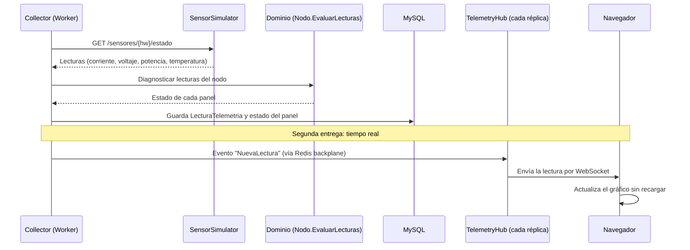

# Capa de Presentación - Web ASP.NET Core MVC & SignalR

## Estructura de Vistas

* `/Views/Parques/`, `/Views/Nodos/`, `/Views/Paneles/`: Gestión CRUD multiparque, un controlador por recurso.
* `/Views/Monitoreo/`: Dashboard en tiempo real con gráficos dinámicos (Chart.js / ApexCharts + SignalR).
* `/Views/Mantenimiento/`: Calendario y lista de tareas para paneles.
* `/Views/Chat/`: Interfaz para consultas en Lenguaje Natural con Gemini y las herramientas MCP.

## Controladores y Vistas "tontos"

* La única responsabilidad de un controlador es recibir el pedido, validar el formato de la entrada, llamar a un servicio de `Application` y elegir la vista o redirección. La de una vista es mostrar datos.
* El agente **debe rechazar o advertir** si se escribe lógica de negocio en un controlador o una vista: un `if/switch` que decide reglas del dominio, o un `foreach` que suma la potencia de los paneles. Eso va en el Dominio o en un servicio, y el controlador recibe un DTO con los datos ya calculados.

## Forma de una acción que modifica datos

1. Si `ModelState` no es válido, devolver la misma vista con el ViewModel recibido.
2. Convertir el ViewModel en el `Request` del servicio.
3. Llamar al servicio.
4. Si el servicio lanza una excepción de dominio esperable (ej. nombre duplicado), agregar el mensaje a `ModelState` y devolver la vista. No capturar `Exception` genérica.
5. Si todo salió bien, redirigir con `RedirectToAction`. Nunca devolver una vista después de un POST exitoso.

## ViewModels, no Entidades

* Las vistas **nunca** reciben ni envían entidades del Dominio: usan un `ViewModel`.
* El ViewModel de un formulario solo tiene los campos que el usuario puede editar: sin `Id` en el alta y sin colecciones de navegación. Esto evita que alguien envíe datos que no debería poder cambiar (*overposting*).
* Las etiquetas (`[Display]`) y validaciones de formato (`[Required]`, `[StringLength]`, `[Range]`) se declaran en el ViewModel.
* Las opciones de los desplegables (ej. elegir el parque al crear un nodo) las trae el controlador desde un servicio.

## Seguridad

* Los controladores de gestión llevan `[Authorize(Roles = "Administrador")]` a nivel de clase. El nombre del rol debe coincidir exactamente con el de Keycloak.
* Toda acción `[HttpPost]` lleva `[ValidateAntiForgeryToken]`.
* Crear, editar y eliminar son siempre POST. Una acción GET nunca cambia datos.
* No escribir `if (User.IsInRole(...))` dentro de las acciones para decidir reglas de negocio.

## Vistas

* Usar *Tag Helpers* (`asp-for`, `asp-action`, `asp-validation-for`) en lugar de escribir a mano `name`, `id` o URLs.
* Usar el layout compartido y vistas parciales para no repetir el formulario entre `Crear` y `Editar`.
* Todo texto visible va en español.
* El JavaScript se reserva para el tiempo real (SignalR) y los gráficos; no usarlo para lo que MVC resuelve con un formulario.

## Secuencia de Telemetría y Monitoreo

"El sensor mide, el dominio decide": el simulador solo informa números; qué es una falla lo decide `Nodo.EvaluarLecturas`. Los pasos de SignalR son de la segunda entrega; hoy las lecturas se ven en el detalle de cada panel.
