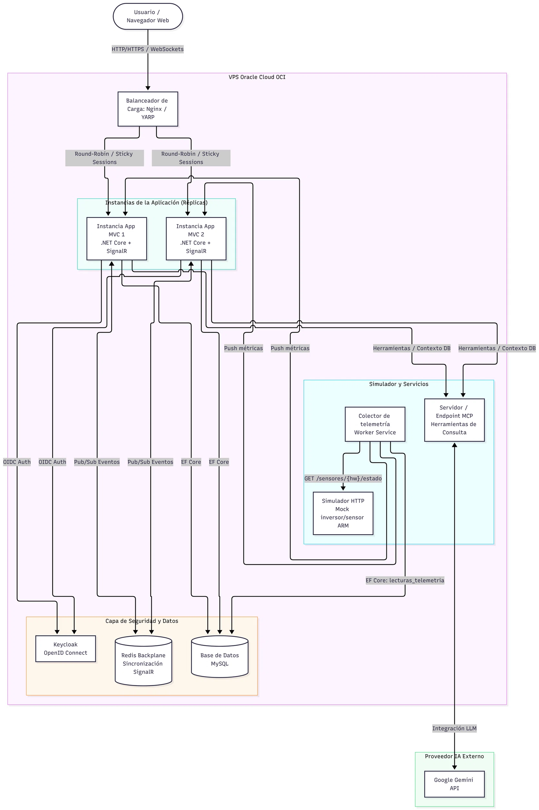
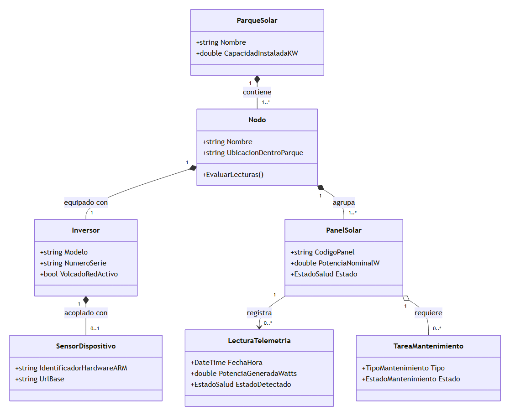

# SolarUY — Documentación del sistema

| | |
|---|---|
| **Proyecto** | SolarUY — gestión de parques solares y telemetría |
| **Equipo** | Gonzalo Buriano · Guillermina Rodriguez · Mariano Ramos · Fabricio Rivero |
| **Materia** | Taller de Programación .NET 2026 — UTEC |
| **Repositorio** | `github.com/6buriano/.NetSolarUY` — rama `main` |
| **Actualizado** | 28/10/2026 |

**Cómo está organizado.** Las secciones 1 a 5 describen el sistema para quien necesita entender **qué hace**
y **cómo está armado**, sin entrar en el código. La sección 6 cuenta **cómo lo desarrollamos** y la 7 cómo lo
verificamos. El detalle de implementación (contrato HTTP con el hardware, tablas, configuración) está en el
anexo B, separado a propósito: es información para un lector técnico.

## 1. Resumen

SolarUY administra parques solares: sus nodos (cada uno con un inversor y un sensor ARM) y sus paneles. Además
**recibe la telemetría de los sensores**, decide el estado de salud de cada panel y guarda el histórico de
generación. Lo usan dos perfiles: quien administra el parque (altas, bajas y cambios) y quien lo opera
(estado de los paneles, órdenes al hardware, mantenimiento, consultas de generación).

Está construido en .NET 10 con Clean Architecture, MySQL sobre Docker y ASP.NET Core MVC con vistas Razor.
El hardware se simula con un servicio HTTP aparte, así que el día que existan sensores reales el sistema no
cambia: se reemplaza el cliente que habla con el hardware.

**Estado:** todas las funcionalidades de las secciones 5.1 a 5.7 están implementadas y verificadas; la
solución compila sin errores ni advertencias y pasan 179 pruebas automáticas. Lo que falta está en la
sección 11.

## 2. Qué hace el sistema

| Módulo | Qué resuelve | Quién lo usa |
|---|---|---|
| **Parques, nodos y paneles** | Altas, bajas y modificaciones con búsqueda y detalle. Un nodo incluye su inversor y, opcionalmente, su sensor ARM. | Administración |
| **Telemetría** | Un colector consulta los sensores cada pocos segundos, guarda las lecturas y diagnostica el estado de cada panel (operativo, rendimiento bajo, falla, desconectado). | Operación |
| **Órdenes al hardware** | Activar o desactivar un panel y el volcado a la red del inversor, desde la pantalla de detalle. | Operación |
| **Mantenimiento** | Tareas programadas sobre un panel, con tipo, responsable y ciclo de vida (pendiente, en proceso, completada, cancelada). | Mantenimiento |
| **Consultas históricas** | Generación de un panel agrupada por día, mes o año, con potencia promedio, máxima y energía estimada. | Administración y operación |
| **Diagnóstico** | Pantalla de apoyo que compara lo cargado en el sistema contra el hardware simulado y lista lo que no cierra. Solo en desarrollo. | Equipo de desarrollo |
| **Acceso** | Inicio de sesión con Keycloak; el ABM, el mantenimiento, el histórico y el diagnóstico piden el rol `Administrador`. El inicio y `/health` quedan abiertos. | Todos |

## 3. Arquitectura

### 3.1 El sistema en una imagen

**Arquitectura y despliegue.** El usuario entra por **Nginx**, que manda todo el tráfico a `web1`; `web2`
queda de respaldo y solo recibe pedidos si `web1` no responde. Las dos réplicas son idénticas y **no guardan
sesión en el servidor**: comparten el anillo de claves de cifrado en un volumen, así que cualquiera puede
atender un formulario que empezó la otra. Comparten también **MySQL**, donde viven parques, paneles,
mantenimiento y telemetría. Aparte corren el **colector** (el único que escribe las lecturas) y el
**simulador del hardware**, que es una caja negra HTTP: no conoce la base ni nuestro dominio. El login lo
resuelve **Keycloak** por OpenID Connect. El detalle de cada caja y cómo se levanta está en el anexo B.

### 3.2 Por qué elegimos estas tecnologías

| Tema | Decisión | Por qué |
|---|---|---|
| Estilo de arquitectura | **Monolito modular con Clean Architecture** (Domain, Application, Infrastructure, Web y Collector) | Para el alcance del trabajo, un solo despliegue es más simple de operar que microservicios. Las capas separan las reglas del negocio de la tecnología y se pueden probar por separado. |
| Interfaz web | **ASP.NET Core MVC con vistas Razor** | El sistema son formularios y listados, que MVC resuelve en el servidor. El tiempo real se agrega con SignalR sólo donde haga falta (monitoreo), no en todo el sistema. |
| Base de datos | **MySQL 8.4 + Entity Framework Core** (Pomelo) | Los datos son relacionales (parque → nodo → panel → lecturas). EF Core aporta las migraciones que versionan el esquema, y MySQL es gratuito y corre en Docker igual que el resto del entorno. |
| Hardware simulado | **Simulador como servicio HTTP independiente** (repositorio propio, integrado como submódulo) **más un colector propio** que lo consulta | Simula el hardware como caja negra, igual que uno real: el sistema le habla a través de una interfaz, así que reemplazarlo por hardware de verdad no toca el resto. El colector deja al dominio ignorante del transporte. |
| Autenticación | **Keycloak** (OpenID Connect) | La letra pide un proveedor externo. Es open source, corre en nuestro propio servidor y maneja los roles que necesita el sistema (`Administrador`). |
| Despliegue | **Docker Compose** sobre un VPS (Oracle Cloud) | Control total del servidor para correr Nginx, las réplicas, el colector y MySQL con la misma definición de contenedores que usamos en desarrollo. |
| Alta disponibilidad | **Dos réplicas idénticas en activo/pasivo detrás de Nginx** (`web2` en `backup`, con `max_fails`/`fail_timeout`), sin Redis ni sticky sessions, y actualización de a una réplica | Permite actualizar sin cortar el servicio. Como la sesión no vive en el servidor, `web2` puede atender cualquier formulario: no hacen falta sticky sessions ni backplane de SignalR. Limitación conocida: al estar en un solo servidor, una caída afecta a todo. |
| Consultas con IA *(pendiente)* | **Servidor MCP + Gemini** | La letra pide consultas en lenguaje natural sobre el estado del sistema. MCP expone herramientas de consulta y Gemini interpreta la pregunta, sin acoplar el modelo a la base. |

### 3.3 Detalle del diseño: las capas

Las dependencias apuntan siempre hacia el centro: el dominio no conoce a nadie, y las capas de afuera
conocen a las de adentro.

| Proyecto | Responsabilidad |
|---|---|
| `SolarUY.Domain` | Las entidades y las reglas del negocio. C# puro, sin librerías externas. |
| `SolarUY.Application` | Los casos de uso (servicios), los DTOs y los contratos de servicios externos. |
| `SolarUY.Infrastructure` | EF Core + MySQL, repositorios y los clientes HTTP del sensor y del simulador. |
| `SolarUY.Web` | Las pantallas: controladores y vistas Razor. |
| `SolarUY.Collector` | El proceso que consulta los sensores y guarda la telemetría. |
| `SolarUY.SensorSimulator` | El mock del hardware (submódulo aparte). No conoce nuestro dominio. |
| `SolarUY.Domain.Tests` | Las pruebas de las reglas del dominio. |

Reglas de la casa: **un controlador y un servicio por recurso** (para que cada integrante trabaje en sus
archivos), **las reglas de negocio viven en el dominio** y se expresan con excepciones que las pantallas
muestran como mensajes, y **los controladores nunca tocan Infrastructure**: sólo llaman a Application.
El modelo de clases está en la sección 4 y el contrato con el hardware en el anexo B.

## 4. Modelo de dominio

### 4.1 Diagrama de clases

Siete entidades y tres enumeraciones. Lo importante no es la lista de campos sino las reglas que el dominio
hace cumplir (§4.3) y que el sensor **mide** pero **no diagnostica**: el estado de cada panel lo decide
`Nodo.EvaluarLecturas`, porque sólo el nodo ve a los paneles hermanos contra los que hay que comparar. Los
estados de salud son `OPERATIVO`, `RENDIMIENTO_BAJO`, `FALLA_DETECTADA` y `DESCONECTADO`; los tipos de
mantenimiento, `LIMPIEZA`, `REPARACION`, `INSPECCION_PREVENTIVA` y `REEMPLAZO`; y una tarea de mantenimiento
está `PENDIENTE`, `EN_PROCESO`, `COMPLETADA` o `CANCELADA`. El diagrama completo, con todos los campos y
métodos, está en `Documentacion/diagrama-clases.md`.

### 4.2 Entidades

`ParqueSolar` agrupa `Nodo`; cada nodo tiene exactamente un `Inversor`, que puede tener un `SensorDispositivo`;
cada nodo agrupa `PanelSolar`, y cada panel acumula `LecturaTelemetria` y `TareaMantenimiento`. Los estados de
salud son `OPERATIVO`, `RENDIMIENTO_BAJO`, `FALLA_DETECTADA` y `DESCONECTADO`.

### 4.3 Reglas de negocio

1. Un nodo no puede existir sin exactamente un inversor.
2. El número de serie del inversor es único en todo el sistema, y el identificador de hardware del sensor
   también.
3. Un parque con nodos no se puede eliminar, y un nodo con paneles tampoco.
4. El código de panel es único dentro de su nodo: es el vínculo con el panel que informa el sensor.
5. **Estado de salud.** El sensor mide; el dominio decide: `DESCONECTADO` si el panel está inactivo,
   `FALLA_DETECTADA` arriba de 75 °C y, para la potencia, una caída medida contra el promedio de los otros
   paneles activos del mismo nodo (normalizada por potencia nominal) en tres bandas: hasta 15 % sigue
   `OPERATIVO`, más de 15 % y hasta 40 % es `RENDIMIENTO_BAJO`, más de 40 % es `FALLA_DETECTADA`. De noche, o
   con menos de dos paneles activos con lectura, sólo manda la temperatura.
6. **Mantenimiento.** Una tarea completada no se reprograma ni se cancela; sólo una pendiente pasa a en
   proceso, y sólo una en proceso se completa (ahí se guarda la fecha de realización).

## 5. Funcionalidades

### 5.1 Parques, nodos y paneles

Cada recurso tiene listado con filtros, alta, edición, detalle y baja con confirmación. El alta de un nodo
carga juntos los datos del inversor (regla 1) y, si se indica, los del sensor ARM: identificador de hardware,
dirección y firmware.

El sensor es **opcional**. Si se escribe un identificador que el simulador todavía no emula, la pantalla no
guarda un nodo muerto: avisa cuáles existen y ofrece dos salidas —**crear el sensor** en el simulador y
seguir con el alta, o **crear el nodo sin sensor**, que queda cargado y sin telemetría hasta que le asignen
uno—. La pantalla informa además qué códigos de panel tendrá que cargar el usuario, porque el alta de un nodo
no crea los paneles.

### 5.2 Telemetría

Un proceso aparte, el **colector**, consulta cada pocos segundos a los sensores de los nodos activos, empareja
lo que informa el sensor con los paneles del sistema por código, deja que el dominio diagnostique y guarda una
lectura por panel. Si un sensor no responde, se saltea esa ronda para ese nodo y los demás siguen: una falla
de hardware no detiene la recolección.

El resultado se ve en el detalle de cada panel: la última lectura (corriente, voltaje, potencia, temperatura y
estado) y la serie de las últimas 20, con las horas en hora de Montevideo y las filas en falla y en rendimiento
bajo resaltadas.

### 5.3 Órdenes al hardware

Desde el detalle de un panel se puede **activar o desactivar ese panel** en el sensor; desde el detalle de un
nodo, **activar o desactivar el volcado a la red**. La orden viaja al sensor y la pantalla confirma qué pasó:
enviada, ya estaba en ese estado, el simulador no reconoce ese panel o sensor, o el sensor no respondió. El
cambio se refleja en la telemetría de la ronda siguiente. Si el nodo no tiene sensor no hay a quién mandarle
la orden, y la pantalla lo dice.

### 5.4 Mantenimiento

Las tareas se programan sobre un panel con su tipo (limpieza, reparación, inspección preventiva, reemplazo),
fecha, descripción y personal asignado. Se listan con filtros por panel y por estado, se pueden reprogramar
mientras no estén completadas y avanzar por el ciclo pendiente → en proceso → completada, o cancelarse. El
detalle de cada panel muestra su historial de mantenimiento.

### 5.5 Consultas históricas

Se elige un panel, una granularidad (día, mes o año) y, opcionalmente, un rango de fechas. La pantalla
devuelve una fila por período con la cantidad de lecturas, la potencia promedio, la potencia máxima y la
**energía estimada**. La energía se estima a partir de la potencia instantánea que guarda el colector, así que
es una aproximación y así se aclara en la pantalla: no es un medidor de energía.

### 5.6 Diagnóstico (herramienta de desarrollo)

Compara los parques, nodos, sensores y paneles cargados contra el inventario del simulador y lista lo que no
cierra, más cuántos identificadores de sensor quedan libres. **Sólo informa**: las altas se hacen en el ABM.
Existe únicamente en desarrollo, porque depende de una API que sólo tiene el simulador.

### 5.7 Acceso y roles

El inicio de sesión lo resuelve **Keycloak**: la aplicación no guarda usuarios ni contraseñas, sólo confía en
lo que Keycloak le responde y exige el rol `Administrador` para el ABM, el mantenimiento, el histórico y el
diagnóstico. El inicio y `/health` quedan abiertos (el segundo para el chequeo de vida del despliegue).

## 6. Proceso de desarrollo con IA

No usamos la IA como generador de código suelto: cada funcionalidad pasa por **desarrollo guiado por
especificaciones (SDD)** y queda documentada en `prompting/`.

### 6.1 El ciclo

1. **`requirements.md`** — qué se necesita y sus criterios de aceptación. Lo escribe una persona.
2. **`specs.md`** — el diseño capa por capa. Lo genera la IA con la skill `sdd-generar-specs` y **lo aprueba
   una persona** antes de seguir.
3. **`tasks.md`** — los pasos de implementación, de adentro hacia afuera. Lo genera la IA con la skill
   `sdd-generar-tasks`.
4. **Código** — una tarea por vez y un commit por tarea, con un mensaje que la nombre. Al terminar cada una,
   la verificación se hace con la skill `verificar-calidad`.

`requirements.md` y `specs.md` se commitean **antes** del código, y el pull request de cada requerimiento
incluye su carpeta de `prompting/` junto con los cambios.

### 6.2 Reglas y skills

| Carpeta | Contenido |
|---|---|
| `.agents/rules/` | Las reglas que la IA respeta siempre: arquitectura, SOLID, nomenclatura, modelado del dominio, capa de presentación y flujo de trabajo con IA. |
| `.agents/skills/` | `sdd-generar-specs`, `sdd-generar-tasks` y `verificar-calidad` (compilar, tests de arquitectura, tests del dominio y Sonar, corrigiendo lo que falle). |

### 6.3 Las funcionalidades documentadas

| Carpeta | Funcionalidad | Documentación |
|---|---|---|
| `req001_abm_parque_solar` | ABM de parques | Retroactiva |
| `req002_autenticacion_keycloak` | Login con Keycloak y roles | Retroactiva |
| `req003_abm_nodos` | ABM de nodos con su inversor | Retroactiva |
| `req004_abm_paneles` | ABM de paneles | Retroactiva |
| `req005_recoleccion_telemetria` | Colector y diagnóstico de paneles | Retroactiva |
| `req006_diagnostico_vinculacion` | Pantalla de diagnóstico | Retroactiva |
| `req007_alta_disponibilidad` | Nginx, réplicas y actualización sin cortes | Retroactiva |
| `req008_acciones_sensor` | Órdenes al hardware desde la interfaz | Retroactiva |
| `req009_mantenimiento` | Tareas de mantenimiento | Retroactiva |
| `req010_consultas_historicas` | Consultas de generación por período | Retroactiva |

Los requerimientos 001 a 007 se documentaron **después** de implementar, cuando adoptamos el proceso; desde el
008 la idea es escribir los documentos antes del código. Cada `tasks.md` cierra con una sección **Uso de IA**
que registra qué generó la IA, qué corrigió una persona y qué encontraron las verificaciones.

### 6.4 Versionado e integración continua

Nadie trabaja directo en `main`: cada uno abre una rama y un pull request que otro revisa. Cada push y cada
pull request a `main` dispara una **integración continua** que restaura, compila en Release y corre las
pruebas; no necesita base ni simulador porque las pruebas no tocan infraestructura.

### 6.5 Lo que falta del proceso

La skill `verificar-calidad` ya está escrita y define el chequeo completo, pero **todavía no están integrados**
los tests de arquitectura (`tests/CodeQuality.Tests`, con ArchUnitNET) ni el análisis de SonarQube
(`tools/SonarQube/`). Mientras tanto la verificación es compilación, tests y prueba manual de cada criterio.

## 7. Verificación y calidad

### 7.1 Automática

- `dotnet build SolarUY.slnx` → **0 errores y 0 advertencias** (incluye el submódulo del simulador).
- `dotnet test` → **179 pruebas, 0 fallos**: 109 del dominio y 70 del simulador.
- `dotnet list package --vulnerable` → sin paquetes vulnerables.
- Integración continua en cada push y pull request a `main` (compilación en Release y pruebas).

### 7.2 Funcional

Las funcionalidades se probaron contra el simulador corriendo, con MySQL y el colector activos:

| Prueba | Resultado |
|---|---|
| Alta de parque, nodo y paneles desde las pantallas | ✅ Se crean y aparecen en los listados con sus filtros |
| Alta de nodo con un sensor que el simulador no emula | ✅ Avisa cuáles existen y ofrece crearlo o seguir sin sensor |
| Elegir "crear el sensor en el simulador" | ✅ El simulador empieza a emularlo y el nodo queda con ese sensor |
| Agregar un sensor a un nodo que ya existía (edición) | ✅ Se guarda correctamente |
| Colector contra el sensor creado desde la pantalla | ✅ Guarda las lecturas de todos los paneles del nodo cada ronda |
| Forzar sobretemperatura y después levantarla | ✅ Pasa a `FALLA_DETECTADA` y vuelve solo a `OPERATIVO` |
| Activar y desactivar un panel desde el detalle | 🟡 La orden llega al sensor y el cambio se ve en la ronda siguiente |
| Ciclo completo de una tarea de mantenimiento | 🟡 Pendiente → en proceso → completada, con su fecha de realización |
| Consulta histórica por día, mes y año | 🟡 Devuelve los períodos con promedio, máximo y energía estimada |
| Pantalla de Diagnóstico | ✅ "Todo vinculado", sin errores ni avisos |

Las filas marcadas 🟡 corresponden a la iteración 2: están implementadas, compilan y tienen su
`requirements.md` con los criterios de aceptación, pero **la prueba manual contra el simulador todavía no está
registrada**: la tiene que confirmar quien implementó cada una.

### 7.3 Evidencia

**Listado de nodos.** Cada nodo con su inversor y la cantidad de paneles.

**Detalle del nodo.** El inversor y el sensor `ARM-004`, creado desde el propio formulario de alta.

**Alta con un identificador inexistente.** La pantalla avisa cuáles existen y ofrece las dos salidas.

**Detalle del panel.** Última lectura y serie de las últimas 20, en hora de Montevideo.

**Panel en falla.** Forzando sobretemperatura, el dominio diagnostica `FALLA_DETECTADA` en la ronda siguiente.

**Diagnóstico.** Comparación del sistema contra el inventario del simulador.

### 7.4 Lo que falta verificar

Tests de arquitectura y SonarQube (ver §6.5), y cobertura automática de los servicios de aplicación y los
controladores: hoy las pruebas automáticas cubren las siete entidades del dominio y el simulador, y el resto
se verifica a mano con la tabla de §7.2.

## 8. Cómo levantar y probar

Hay dos modos, y la guía paso a paso para alguien nuevo es `Documentacion/PRUEBA-RAPIDA-SolarUY.md`:

- **Docker** (la topología de la entrega): `docker compose up -d`, se migra una sola vez con el perfil
  `migracion` y todo entra por `http://localhost:8080` (Nginx → `web1`/`web2`).
- **Host** (`dotnet run`): sólo MySQL en Docker; la web y el colector en la máquina, en
  `http://localhost:5192`.

Los dos necesitan el **secreto del cliente de Keycloak** (no está en el repositorio): en el modo host se
configura con `dotnet user-secrets` y en Docker por la variable `KEYCLOAK_CLIENT_SECRET` del `.env`. El
detalle está en `README.md` y en `Documentacion/keycloak.md`.

## 9. Estado del repositorio

| | |
|---|---|
| Rama | `main` |
| Último commit | `322f9f3` — "Consultas históricas" (28/10) |
| Migraciones | `20261012172223_MigracionInicial`, `20261013002412_VinculacionConElSensor` |
| Documentación | `README.md`, `specs.md`, `Documentacion/` (esta guía, prueba rápida, Keycloak, actualización sin cortes y los dos diagramas) |

Cronología, según el historial del repositorio:

| Fecha | Trabajo |
|---|---|
| 06/10 | `specs.md`, reglas de arquitectura y convenciones, primer `README.md` |
| 12/10 | Solución base en capas (PR #1), modelo de dominio, ABM de Parques, Nodos y Paneles, simulador como submódulo, colector de telemetría |
| 13/10 | Diagnóstico de vinculación, horas en hora local y serie de lecturas por panel |
| 14/10 | Alta de nodo con sensor inexistente y cierre de la primera entrega |
| 19–21/10 | Login con Keycloak, roles, Nginx, réplicas y despliegue Docker con migración única |
| 26/10 | Proceso SDD: reglas y skills en `.agents/`, y los requerimientos 001 a 007 documentados |
| 28/10 | Órdenes al hardware desde la interfaz, mantenimiento y consultas históricas |

## 10. Riesgos y limitaciones

1. **Volumen de telemetría.** El colector escribe 15 filas cada 5 segundos: unas 260.000 por día. Todavía no
   hay política de retención, así que no conviene dejarlo corriendo varios días.
2. **Los sensores creados en el simulador viven en su memoria.** Si se reinicia el contenedor, desaparecen y
   esos nodos quedan sin telemetría hasta recrearlos.
3. **Un solo servidor.** Las réplicas protegen de una caída de proceso o de una actualización, no de que se
   caiga la máquina: la base y el servidor son un punto único.
4. **La energía de los históricos es estimada**, no medida: sale de la potencia instantánea y el intervalo de
   lectura.
5. **Sin dashboard ni gráficos.** Las lecturas se ven como tabla en el detalle del panel y en el histórico.
6. **Cobertura de pruebas concentrada en el dominio** (§7.4).

## 11. Próximos pasos (iteración 3)

1. **Consultas en lenguaje natural (MCP + Gemini)**: herramientas de sólo lectura sobre el estado y la
   generación, tal como pide la letra.
2. **Tests de arquitectura y SonarQube**: integrar `tests/CodeQuality.Tests` y `tools/SonarQube/` para que la
   skill `verificar-calidad` quede completa (§6.5).
3. **Monitoreo en tiempo real**: hub de SignalR y dashboard con gráficos, alimentado por el colector que ya
   existe.
4. **Política de retención** de `lecturas_telemetria` antes de dejar el colector corriendo varios días.
5. **Cobertura de pruebas** de los servicios de aplicación y los controladores.

---

## Anexo A — Esquema de iteraciones

| Iteración | Fecha | Contenido |
|---|---|---|
| **1** | 14/10 | Modelo de dominio; ABM de Parques, Nodos y Paneles (un módulo por integrante); simulador de inversores |
| **2** | 28/10 | Keycloak y roles; alta disponibilidad con Nginx y réplicas; órdenes al hardware; mantenimiento; consultas históricas; proceso SDD |
| **3** | 11/11 | Consultas en lenguaje natural (MCP); y los pendientes de la sección 11 |

## Anexo B — Detalle técnico

### B.1 El contrato con el hardware

El simulador (`SolarUY.SensorSimulator`) es una API HTTP con este contrato, documentado en
`SolarUY.SensorSimulator/docs/7_simulador_sensor.md`:

| Operación | Qué hace |
|---|---|
| `GET /sensores/{hw}/estado` | Telemetría de todos los paneles del sensor; el colector la usa en cada ronda |
| `GET /simulador/inventario` | Sensores y paneles que el simulador emula (lo usa la pantalla de Diagnóstico) |
| `POST /simulador/sensores` | Empezar a emular un sensor nuevo (lo usa el alta de nodos) |
| `POST /simulador/fallas/{hw}/{panel}?tipo=…` | Forzar una falla (sobretemperatura o caída de potencia) para la demo |
| `DELETE /simulador/fallas/{hw}/{panel}` | Levantar la falla |
| `POST /sensores/{hw}/paneles/{panel}/activar` · `/desactivar` | Órdenes de activación de un panel |
| `POST /sensores/{hw}/volcado/activar` · `/desactivar` | Órdenes de volcado a la red |

Por defecto emula 3 sensores (`ARM-001`…`ARM-003`) con 5 paneles cada uno (`P01`…`P05`) de 300 W, con una
curva solar que da 0 W de noche, zona horaria `America/Montevideo` y una probabilidad de falla configurable.

### B.2 Persistencia

MySQL 8.4 con EF Core y Pomelo 9.0.0. Tablas: `parques_solares`, `nodos`, `inversores`,
`sensores_dispositivos`, `paneles`, `lecturas_telemetria` y `mantenimientos`. Las reglas de unicidad del
dominio están además respaldadas con índices únicos (número de serie, identificador de hardware, un inversor
por nodo, código de panel por nodo). El esquema se versiona con dos migraciones; el mantenimiento y los
históricos no necesitaron cambios de esquema.

### B.3 Configuración y despliegue

| Pieza | Configuración |
|---|---|
| Cadena de conexión | `ConnectionStrings:SolarUY` (en desarrollo, `appsettings.Development.json`) |
| Keycloak | `Keycloak:Authority`, `ClientId` y `ClientSecret` (el secreto, por user secrets o `KEYCLOAK_CLIENT_SECRET`) |
| Colector | `Colector:Habilitado` y `Colector:IntervaloSegundos` |
| Simulador | `Simulador:UrlBase` para la web; la dirección del sensor de cada nodo es un dato, no configuración |
| Anillo de claves | Volumen compartido `solaruy-data-protection` entre las réplicas |

En el despliegue, el paso `migracion` aplica el esquema y crea el anillo de claves una sola vez; las réplicas
no migran al arrancar para que dos instancias no compitan por el esquema. La secuencia de actualización sin
cortes está en `Documentacion/actualizacion-sin-cortes.md`.

### B.4 Diagramas fuente

Los dos diagramas de este documento están versionados como código Mermaid, para poder editarlos y volver a
renderizarlos: `Documentacion/diagrama-clases.md` (dominio completo, con todos los campos y métodos) y
`Documentacion/diagrama-infraestructura.md` (arquitectura y despliegue).
