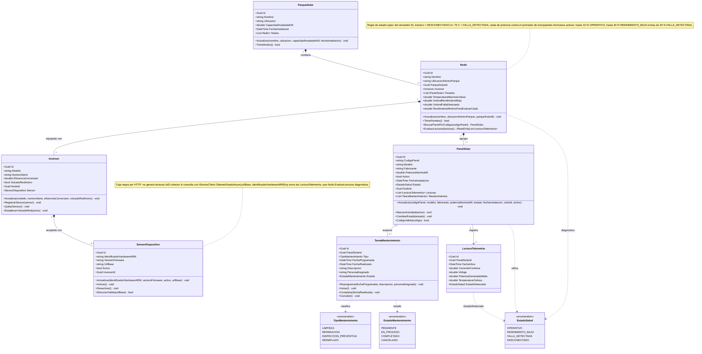

# Diagrama de clases — SolarUY

Modelo de dominio vigente, verificado contra el código de `src/SolarUY.Domain` (14/10/2026).
El código Mermaid de abajo es la versión actualizada: se puede pegar en
[mermaid.live](https://mermaid.live) o renderizar con la extensión de Mermaid de VS Code.

## Cambios respecto de la versión anterior del diagrama

1. **`PanelSolar`**: se agregaron `CodigoPanel` (el vínculo con el panel que informa el sensor, único
   dentro del nodo) y `Activo` (habilita o no el panel en el hardware), más `MarcarActividad`,
   `CambiarEstado` y `CodigoValido`. Los dos campos llegaron en la migración
   `VinculacionConElSensor`.
2. **`SensorDispositivo`**: se agregó `UrlBase`, la dirección donde escucha el sensor, que es lo que
   permite consultarlo por HTTP. Se quitaron `CapturarDatosInversor()` y `EjecutarOrden()`: el sensor no
   genera lecturas en nuestro modelo (es una caja negra que se consulta con
   `ISensorClient.ObtenerEstadoAsync`) y las órdenes viven en el contrato de aplicación
   (`ActivarPanelAsync`, `DesactivarPanelAsync`, `ActivarVolcadoAsync`, `DesactivarVolcadoAsync`),
   todavía sin cablear a la interfaz.
3. **`Nodo`**: se quitó `GetEstadoSaludGeneral()`. Lo que hay es `EvaluarLecturas(lecturas)`, que
   diagnostica las lecturas de todos los paneles del nodo y devuelve el estado de cada una, más
   `BuscarPanelPorCodigo`.
4. **`Inversor`**: se quitó `ConvertirCCaCA()` (la potencia la informa el sensor ya convertida). Se
   agregaron `RegistrarSensor`, `QuitarSensor` y `EstablecerVolcadoRed`. La relación con el sensor pasó a
   **0..1**: el dominio admite un inversor sin sensor (el ABM lo permite y avisa).
5. **`TareaMantenimiento`**: `CompletarTarea(observaciones)` no existe; el método es
   `Completar(fechaRealizada)` y se sumaron `Reprogramar`, `Iniciar` y `Cancelar`. `PersonalAsignado` es
   opcional (`string?`).
6. **`ParqueSolar`**: se quitó `CalcularGeneracionTotalActual()`: requiere agregar lecturas y pertenece
   al hito de Monitoreo. Hoy el parque expone `TieneNodos()`.
7. **Relación `SensorDispositivo ..> LecturaTelemetria`** ("genera"): reemplazada por una nota, porque el
   sensor sólo mide. El camino real es sensor → `ISensorClient` → colector → `Nodo.EvaluarLecturas` →
   `LecturaTelemetria` guardada.
8. Los **enums** ya estaban correctos (`EstadoSalud`, `TipoMantenimiento`, `EstadoMantenimiento`).

## Correspondencia con la base de datos

| Clase | Tabla |
|---|---|
| `ParqueSolar` | `parques_solares` |
| `Nodo` | `nodos` |
| `Inversor` | `inversores` |
| `SensorDispositivo` | `sensores_dispositivos` |
| `PanelSolar` | `paneles` |
| `LecturaTelemetria` | `lecturas_telemetria` |
| `TareaMantenimiento` | `mantenimientos` |

Las reglas que el dominio hace cumplir (unicidad de número de serie y de identificador de hardware,
código de panel único por nodo, un inversor por nodo, no borrar un parque con nodos ni un nodo con
paneles) están además respaldadas con índices y claves foráneas en las migraciones de
`src/SolarUY.Infrastructure/Persistence/Migrations`.
