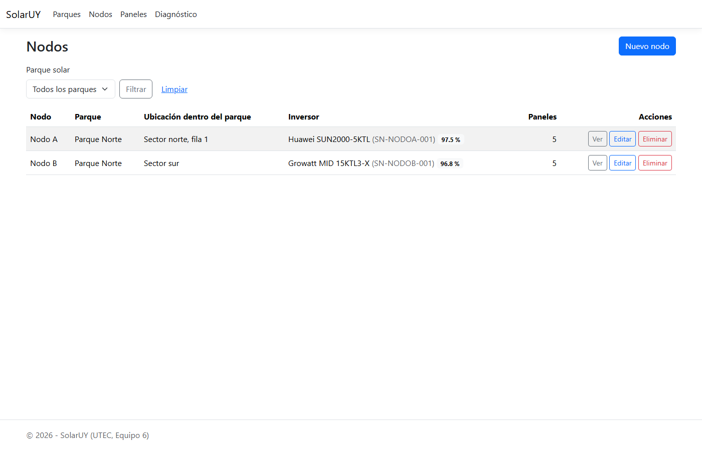
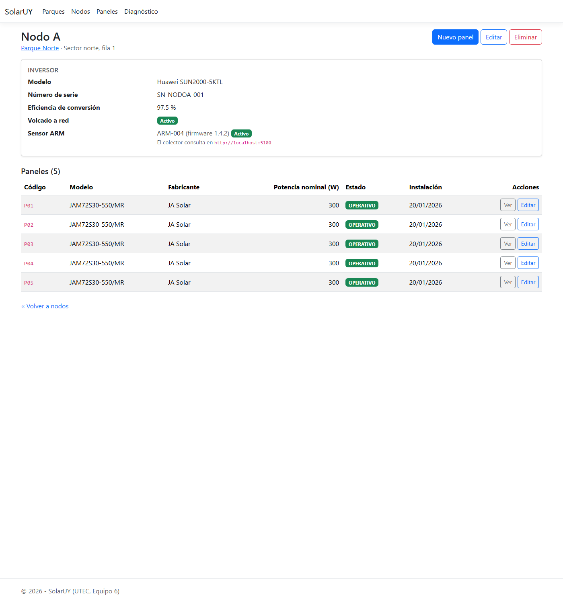
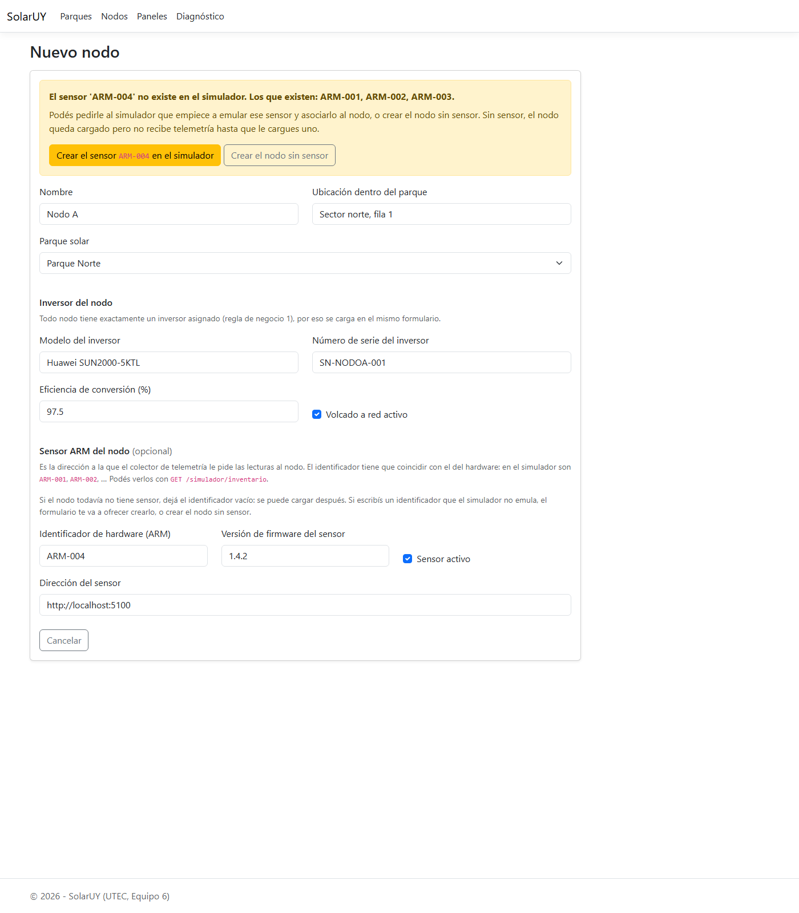
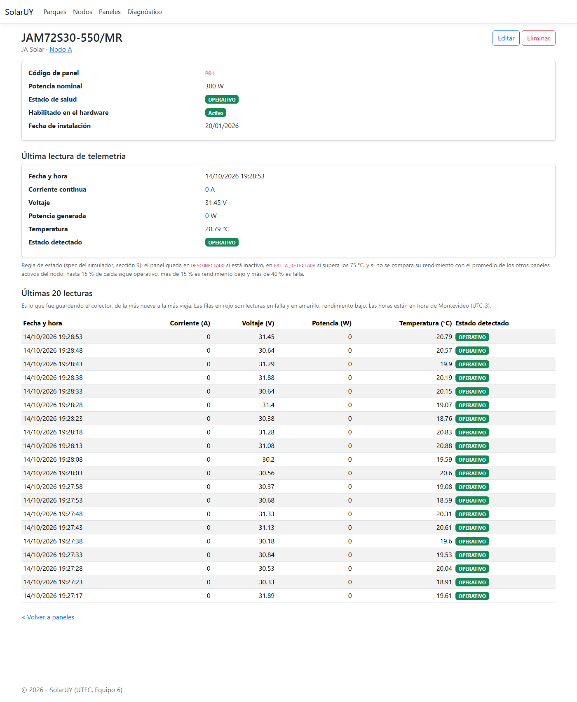
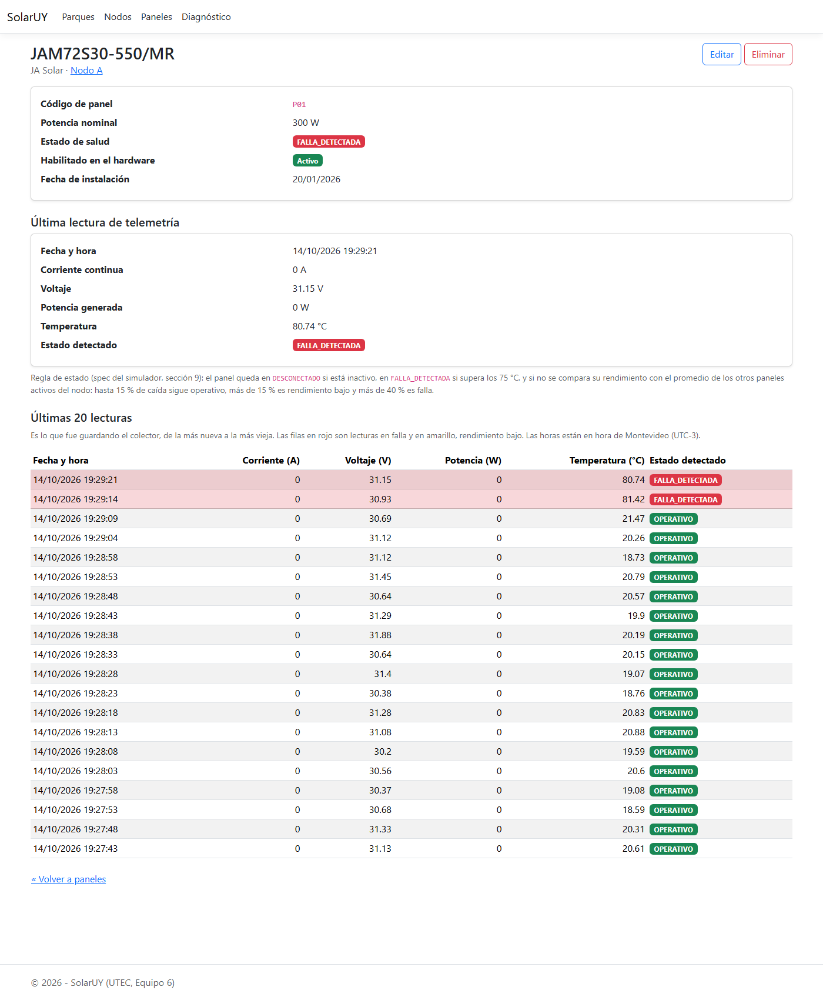
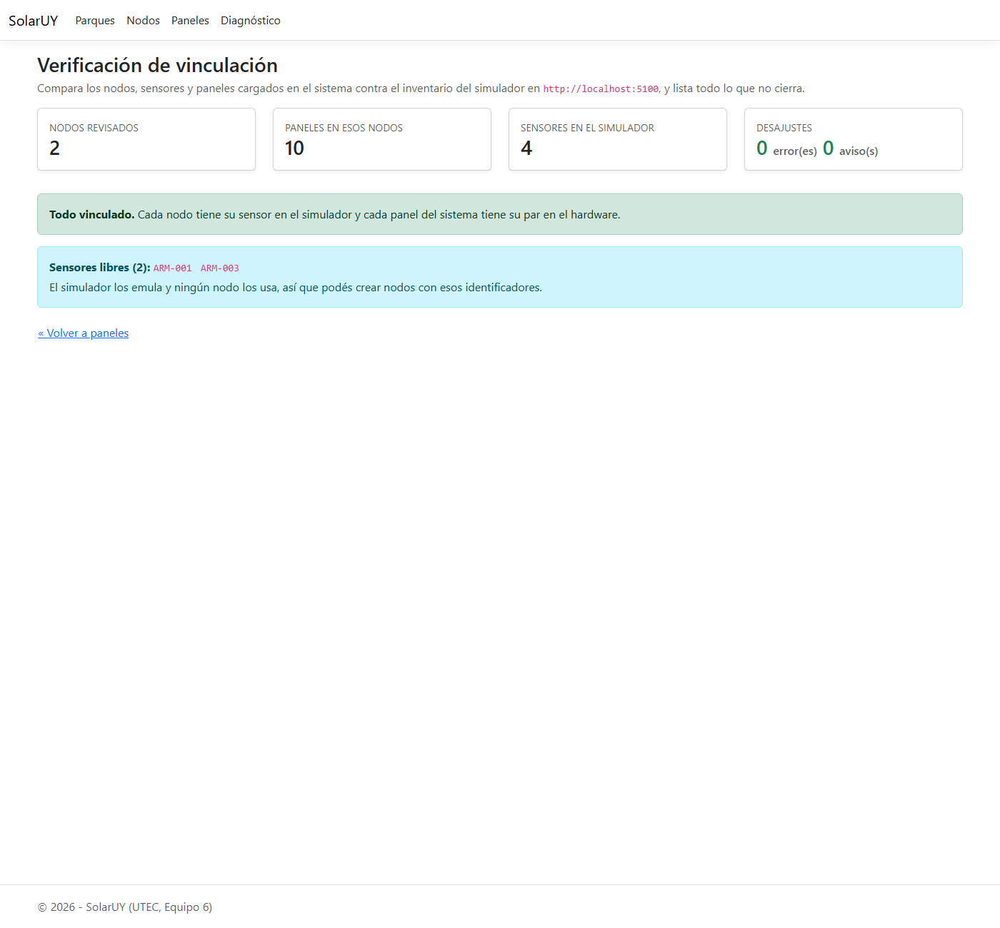
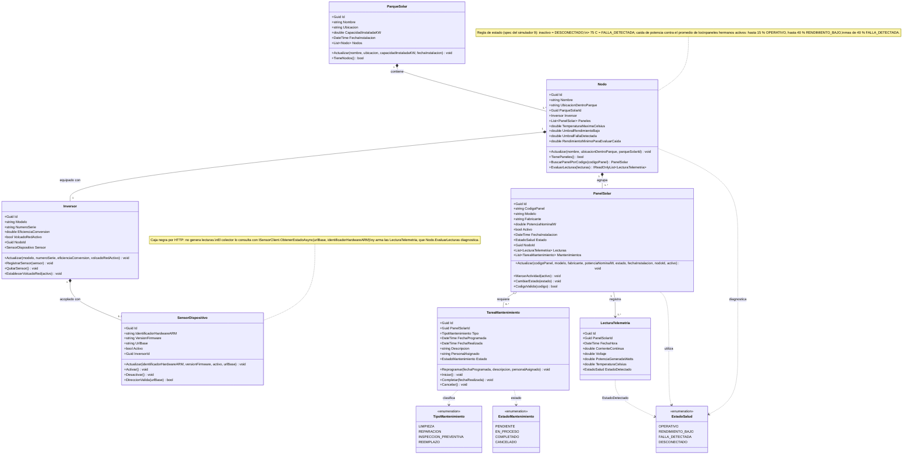

# SolarUY — Primera Entrega (Iteración 1)

**Taller de Programación .NET 2026 · UTEC · Equipo 6**

| | |
|---|---|
| **Entrega** | Primera entrega — Iteración 1 |
| **Fecha** | 14/10/2026 |
| **Repositorio** | `github.com/6buriano/.NetSolarUY` — rama `main` |
| **Submódulo del simulador** | `github.com/RamosMariano/SolarUY.SensorSimulator` |
| **Equipo** | Gonzalo Buriano · Guillermina Rodriguez · Mariano Ramos · Fabricio Rivero |

## 1. Resumen ejecutivo

SolarUY es el sistema de gestión de parques solares del Equipo 6: administra parques, nodos (cada uno con su
inversor y su sensor ARM) y paneles, y recibe la telemetría de los sensores por HTTP, la diagnostica y la
guarda. Está construido en .NET 10 con Clean Architecture (Domain → Application → Infrastructure → Web),
MySQL 8.4 sobre Docker y ASP.NET Core MVC con vistas Razor.

En esta iteración se completaron **todos los objetivos planificados**: el modelo de dominio con sus reglas de
negocio, el ABM de Parques, Nodos y Paneles (un módulo por integrante y un corte vertical completo por
recurso), y el simulador de inversores de Mariano integrado como submódulo git.

Además, el equipo avanzó más allá del plan: el sistema quedó **funcionando de punta a punta**. Un colector
propio consulta al simulador cada 5 segundos, el dominio diagnostica el estado de cada panel, las lecturas
quedan en MySQL y se ven en la pantalla de detalle del panel. Ese trabajo pertenece a la iteración 2
(Monitoreo en tiempo real e Históricos), así que se documenta en la sección 5 como **adelanto**: no se
declara como parte de esta entrega, pero tampoco se descarta.

**Estado de la entrega:** la solución compila sin errores ni advertencias, las **153 pruebas automáticas**
pasan y los flujos principales se verificaron contra el simulador corriendo (sección 6).

## 2. Alcance de la iteración 1: planificado vs. entregado

| Objetivo planificado | Responsable | Estado |
|---|---|---|
| Modelo de dominio: entidades base (Parque, Nodo, Inversor, Panel, Mantenimiento) | Equipo | ✅ Entregado |
| ABM Principal — CRUD de Parques con interfaz gráfica (Razor) | Guillermina | ✅ Entregado |
| ABM Principal — CRUD de Nodos con interfaz gráfica (Razor) | Fabricio | ✅ Entregado |
| ABM Principal — CRUD de Paneles con interfaz gráfica (Razor) | Gonzalo | ✅ Entregado |
| Simulador de inversores: lecturas de potencia y estado | Mariano | ✅ Entregado como submódulo |
| Módulo adicional de Usuario (extra previsto) | — | ⏳ No incluido en esta iteración |

**Criterio de "entregado"** que usamos en esta tabla: la funcionalidad está en el repositorio, compila, tiene
pruebas automáticas o verificación funcional registrada y se puede reproducir con la guía
`PRUEBA-RAPIDA-SolarUY.md`. Todo lo que no cumple eso no figura como entregado (ver sección 5).

## 3. Arquitectura de la solución

Clean Architecture: las dependencias apuntan siempre hacia el centro (el dominio), y cada capa sólo conoce a
las de adentro.

| Proyecto | Tipo | Responsabilidad | Archivos | Líneas |
|---|---|---|---|---|
| `SolarUY.Domain` | Biblioteca | Entidades, enums, reglas de negocio y contratos de repositorio. C# puro. | 16 | 721 |
| `SolarUY.Application` | Biblioteca | Casos de uso (servicios), DTOs y contratos de servicios externos. | 30 | 899 |
| `SolarUY.Infrastructure` | Biblioteca | EF Core + MySQL, repositorios, clientes HTTP del sensor y del simulador. | 23 | 2.283 |
| `SolarUY.Web` | Aplicación MVC | Controladores y vistas Razor del ABM y de las pantallas de telemetría. | 44 | 2.119 |
| `SolarUY.Collector` | Worker Service | Consulta los sensores, evalúa las lecturas y las guarda. | 3 | 166 |
| `tests/SolarUY.Domain.Tests` | xUnit | Pruebas de las reglas del dominio. | 7 | 563 |
| `SolarUY.SensorSimulator` | Minimal API (submódulo) | Mock del hardware: emula sensores ARM e inversores. No conoce nuestro dominio. | — | — |

En total, **unas 6.750 líneas** de C# y Razor propias, más el simulador (que es un repositorio aparte y
aporta 70 pruebas propias).

El **diagrama de clases** del dominio está en `diagrama-clases.md` (código Mermaid, verificado contra el
código) y se reproduce en el anexo B.

### Decisiones técnicas relevantes

1. **ASP.NET Core MVC con vistas Razor, no Blazor**, como pide `specs.md` §5.
2. **Un controlador y un servicio por recurso** (`ParquesController`/`ParqueService`,
   `NodosController`/`NodoService`, `PanelesController`/`PanelService`) para que cada integrante trabaje en
   sus archivos sin conflictos.
3. **Pomelo 9.0.0 y EF Core 9.0.20** aunque la solución apunte a `net10.0`: Pomelo todavía no publicó una
   versión para EF Core 10 y la 9.0.0 corre sin problemas sobre .NET 10.
4. **El simulador es una caja negra por HTTP**, no una clase dentro de Infrastructure: se integra como
   submódulo y nuestro sistema lo consulta *por pull*, como si fuera hardware real. Cambiarlo por hardware
   de verdad sólo implica escribir otro `ISensorClient`.
5. **La cultura de la petición se fija en la invariante** (`RequestLocalization`), porque en un equipo con
   configuración regional de Uruguay (`es-UY`) el valor `120.5` de un formulario se interpretaba como `1205`.
6. **Las reglas de negocio viven en el dominio** y lanzan `ReglaDeNegocioException`, que el controlador
   muestra como mensaje. Los controladores nunca tocan Infrastructure.

## 4. Trabajo realizado por módulo

### 4.1 Modelo de dominio y reglas de negocio

Entidades: `ParqueSolar`, `Nodo`, `Inversor`, `PanelSolar`, `SensorDispositivo`, `LecturaTelemetria` y
`TareaMantenimiento`, con los enums `EstadoSalud` (`OPERATIVO`, `RENDIMIENTO_BAJO`, `FALLA_DETECTADA`,
`DESCONECTADO`), `TipoMantenimiento` y `EstadoMantenimiento`.

Reglas implementadas y cubiertas por pruebas:

1. Un nodo no puede existir sin exactamente un inversor.
2. El número de serie del inversor es único en todo el sistema, y el identificador de hardware del sensor
   también.
3. Un parque con nodos no se puede eliminar, y un nodo con paneles tampoco.
4. El código de panel es único dentro de su nodo: es el vínculo con el panel que informa el sensor.
5. **La regla de estado de la spec del simulador (§9)** vive en `Nodo.EvaluarLecturas`: el sensor mide, el
   dominio diagnostica. `DESCONECTADO` si el panel está inactivo, `FALLA_DETECTADA` arriba de 75 °C y, para
   la potencia, una caída medida contra el promedio de los otros paneles activos del mismo nodo (normalizada
   por potencia nominal) en tres bandas: hasta 15 % sigue `OPERATIVO`, más de 15 % y hasta 40 % es
   `RENDIMIENTO_BAJO`, y más de 40 % es `FALLA_DETECTADA`. De noche, o con menos de dos paneles activos con
   lectura, sólo manda la temperatura.

### 4.2 ABM de Parques

Listado con filtro, alta, edición, detalle y baja con confirmación. Regla: un parque con nodos no se puede
eliminar. Pantallas en `Views/Parques/`, servicio `ParqueService`, repositorio `ParqueRepository`.

### 4.3 ABM de Nodos

El nodo arrastra siempre los datos de su inversor (regla 1), así que el formulario los carga juntos, más la
sección **Sensor ARM del nodo**, que es opcional. El formulario valida el identificador (letras, números,
`-` y `_`) y exige la dirección del sensor cuando hay identificador.

Al dar de alta, si el identificador **no existe en el simulador**, el formulario no guarda un nodo muerto ni
obliga a salir a crearlo por fuera: avisa cuáles existen y ofrece dos salidas —**crear el sensor en el
simulador** (el sistema le pide al simulador que empiece a emularlo y sigue con el alta) o **crear el nodo
sin sensor** (queda cargado, sin telemetría hasta que se le asigne uno)—. En los dos caminos el nodo se crea
con las mismas reglas, y la pantalla informa qué códigos de panel hay que cargarle, porque el alta no crea
los paneles.

### 4.4 ABM de Paneles

Listado con filtros por nodo y por estado, alta, edición, detalle y baja. El detalle muestra la última
lectura de telemetría y la serie de las últimas 20 lecturas, con las horas en hora de Montevideo y las filas
en falla y en rendimiento bajo resaltadas.

### 4.5 Simulador de inversores y sensores

Submódulo `SolarUY.SensorSimulator`: una Minimal API que emula el hardware y expone un contrato HTTP propio
(documentado en `SolarUY.SensorSimulator/docs/7_simulador_sensor.md`). Por defecto emula **3 sensores ARM**
(`ARM-001`…`ARM-003`) con **5 paneles cada uno** (`P01`…`P05`) de **300 W**, con su propia curva solar
(`max(0, sin(π·(hora−6)/12))`, es decir 0 W de noche), zona horaria `America/Montevideo` y una probabilidad
de falla configurable.

Endpoints que usamos: `GET /sensores/{hw}/estado` (telemetría por panel), `GET /simulador/inventario`
(sensores y paneles que emula), `POST /simulador/sensores` (empezar a emular un sensor nuevo) y
`POST`/`DELETE /simulador/fallas/{hw}/{panel}?tipo=sobretemperatura|caidaPotencia` (forzar y levantar fallas
para la demo).

### 4.6 Colector de telemetría: la integración de punta a punta

Como el simulador es caja negra y no conoce nuestro dominio, el flujo se completa con un Worker Service
propio:

```
SolarUY.Collector ──GET /sensores/{hw}/estado──▶ SolarUY.SensorSimulator
      │                                                 └─ mide: corriente, voltaje, potencia, temperatura
      │ 1. empareja por código de panel
      │ 2. Nodo.EvaluarLecturas(...) diagnostica
      │ 3. guarda en MySQL
      ▼
  lecturas_telemetria + paneles.estado
```

Cada ronda (5 segundos, configurable) el colector consulta cada sensor activo con un timeout de 3 segundos,
empareja lo que informa el sensor con los paneles del nodo por código, deja que el dominio diagnostique y
persiste. Si un sensor no responde, avisa por log y sigue con los demás: una falla de hardware no detiene la
recolección.

## 5. Adelantos respecto de la iteración 2

El plan de la iteración 2 es Monitoreo en tiempo real (SignalR), Históricos y reportes, y autenticación OIDC.
Sin proponérnoslo, esta iteración dejó hecha **la base de los dos primeros puntos**. Lo documentamos acá para
que quede claro qué es parte de la entrega y qué es adelanto:

| Adelanto | A qué punto del plan aporta | Estado |
|---|---|---|
| Persistencia de telemetría en `lecturas_telemetria` con dos migraciones de EF Core | Históricos & reportes | ✅ Base terminada |
| Serie de las últimas 20 lecturas por panel en su pantalla de detalle, con hora local | Históricos & reportes | ✅ Terminado (falta agregación y reportes) |
| Colector funcionando de punta a punta contra el simulador | Monitoreo en tiempo real | 🟡 El origen de datos ya existe: falta SignalR y el dashboard |
| Pantalla **Diagnóstico**: compara nodos, sensores y paneles contra el inventario del simulador y lista lo que no cierra | Soporte a la operación y a la demo | ✅ Terminado |
| Alta de nodo con creación del sensor ARM que falta, desde el propio formulario | Soporte a la operación y a la demo | ✅ Terminado |
| Horas en hora de Montevideo (UTC−3) en toda la interfaz | Calidad de la información | ✅ Terminado |

Lo que **no** está empezado de la iteración 2 es la autenticación con Keycloak/OIDC: los tres controladores
del ABM y `Program.cs` tienen el punto de extensión marcado con `TODO`, pero no hay nada implementado.

## 6. Verificación y calidad

### 6.1 Compilación y pruebas automáticas

- `dotnet build SolarUY.slnx` → **0 errores y 0 advertencias** (incluye el submódulo).
- `dotnet test` → **153 pruebas, 0 fallos**: 83 del dominio (`SolarUY.Domain.Tests`) y 70 del simulador
  (`SolarUY.SensorSimulator.Tests`).

### 6.2 Verificación funcional de punta a punta

Con MySQL y el simulador levantados por `docker compose`, la web corriendo y el colector activo:

| Prueba | Resultado |
|---|---|
| Alta de parque desde el ABM | ✅ El parque se crea y aparece en el listado |
| Alta de nodo con un ARM que no existe (`ARM-004`) | ✅ El formulario avisa y ofrece las dos salidas |
| Elegir "crear el sensor en el simulador" | ✅ El simulador pasa a emular `ARM-004` y el nodo queda creado con ese sensor |
| Elegir "crear el nodo sin sensor" | ✅ El nodo se crea sin sensor y el detalle lo informa |
| Editar un nodo sin sensor para agregarle uno existente | ✅ Se guarda correctamente (era el caso que fallaba y quedó corregido) |
| Alta de 5 paneles `P01`…`P05` sobre un nodo | ✅ Los 5 se crean con su código y potencia nominal |
| Colector consultando el sensor creado desde el formulario | ✅ "Ronda de telemetría: 5 lecturas guardadas" cada 5 segundos |
| Forzar sobretemperatura en un panel | ✅ En la ronda siguiente el panel queda `FALLA_DETECTADA` (> 75 °C) |
| Levantar la falla | ✅ El panel vuelve solo a `OPERATIVO` |
| Pantalla de Diagnóstico | ✅ "Todo vinculado": 2 nodos, 10 paneles, 0 errores y 0 avisos |

### 6.3 Evidencia (capturas)



**Listado de nodos.** Los dos nodos de la prueba, cada uno con su inversor y sus 5 paneles.



**Detalle del nodo.** El inversor y el sensor `ARM-004`, que no existía y fue creado desde el propio
formulario de alta.



**Alta de nodo con un ARM inexistente.** El formulario avisa cuáles existen y ofrece las dos salidas.



**Detalle del panel.** La última lectura y la serie de las últimas 20, con las horas en hora de Montevideo
(0 W porque la captura se tomó a las 19:28, fuera de la curva solar del simulador).



**Panel en falla.** Forzando sobretemperatura, el dominio diagnostica `FALLA_DETECTADA` en la ronda
siguiente.



**Diagnóstico.** Comparación del sistema contra el inventario del simulador: todo vinculado, y cuántos
identificadores de sensor quedan libres.

## 7. Cómo levantar y probar el sistema

Está todo en `PRUEBA-RAPIDA-SolarUY.md`, pensado para que lo pueda correr cualquier integrante en 15 minutos:

```bash
git clone --branch main --recurse-submodules https://github.com/6buriano/.NetSolarUY.git
docker compose up -d                 # MySQL 8.4 en localhost:3306 y el simulador en localhost:5100
dotnet tool restore
dotnet build
dotnet run --project src/SolarUY.Web        # http://localhost:5192
dotnet run --project src/SolarUY.Collector  # en otra terminal
```

En desarrollo la web aplica las migraciones sola al arrancar. La guía incluye además la prueba de falla
forzada y una tabla de problemas típicos con su solución.

## 8. Estado del repositorio

| | |
|---|---|
| Rama | `main` |
| Último commit de la iteración | `f100908` — "Cambios antes de entrega 1" (14/10) |
| Migraciones | `20261012172223_MigracionInicial`, `20261013002412_VinculacionConElSensor` |
| Documentación | `README.md`, `specs.md`, `PRUEBA-RAPIDA-SolarUY.md`, `diagrama-clases.md` y las reglas de trabajo con IA (`1_…` a `6_…md`) |

Cronología del sprint, según el historial del repositorio:

| Fecha | Trabajo |
|---|---|
| 06/10 | `specs.md`, las reglas de arquitectura y convenciones, y el primer `README.md` |
| 12/10 | Solución base en capas (PR #1), modelo de dominio, ABM de Parques, Nodos y Paneles, simulador como submódulo, colector de telemetría y `PRUEBA-RAPIDA-SolarUY.md` |
| 13/10 | Verificación de vinculación (Diagnóstico), horas en hora local y serie de lecturas por panel |
| 14/10 | Alta de nodo con sensor ARM inexistente, correcciones del ABM y cierre de la entrega |

## 9. Riesgos y limitaciones conocidas

1. **Volumen de telemetría.** El colector escribe 15 filas cada 5 segundos: unas **260.000 filas por día**.
   Todavía no hay política de retención, así que no conviene dejarlo corriendo varios días.
2. **Los sensores creados en el simulador viven en su memoria.** Si se reinicia el contenedor, el sensor
   desaparece y ese nodo queda sin telemetría hasta recrearlo (o hasta declararlo en `docker-compose.yml`).
3. **Sin autenticación.** El ABM está abierto: falta Keycloak y `[Authorize(Roles = "Administrador")]`.
4. **Sin dashboard ni gráficos.** Las lecturas se ven como tabla en el detalle del panel.
5. **Las órdenes al sensor no están cableadas a la interfaz** (activar/desactivar un panel o el volcado a
   red): el cliente `ISensorClient` ya las implementa, falta el botón.
6. **Cobertura de pruebas concentrada en el dominio.** Los servicios de aplicación y los controladores no
   tienen pruebas automáticas: se verifican a mano (sección 6.2).

## 10. Próximos pasos (iteración 2)

1. **Monitoreo en tiempo real**: hub de SignalR (`TelemetryHub`) y dashboard con gráficos, alimentado por el
   colector que ya existe.
2. **Históricos y reportes**: agregaciones por día, mes y parque sobre `lecturas_telemetria`, y la política
   de retención que hoy falta.
3. **Autenticación OIDC**: Keycloak, mapeo del rol `Administrador` y `[Authorize]` en los tres controladores
   del ABM (los puntos de extensión ya están marcados).
4. **Refinamiento**: pruebas automáticas para los servicios de aplicación y los controladores, y las órdenes
   al sensor desde la interfaz.

---

## Anexo A — Esquema de iteraciones del equipo

| Iteración | Fecha | Contenido planificado |
|---|---|---|
| **1** | 14/10 | Modelo de dominio; ABM de Parques, Nodos y Paneles (un módulo por integrante); simulador de inversores. Extra previsto: módulo de Usuario |
| **2** | 28/10 | Monitoreo en tiempo real con SignalR; históricos y reportes de energía; autenticación OIDC con roles |
| **3** | 11/11 | Consultas en lenguaje natural (MCP); alta disponibilidad con balanceador (Nginx/YARP) y al menos 2 instancias; refinamiento y pulido de calidad |

Adelantos de la iteración 2 ya realizados (sección 5): persistencia y consulta de históricos por panel,
y la pantalla de Diagnóstico como herramienta de verificación con el hardware.

## Anexo B — Diagrama de clases

Versión vigente, verificada contra el código de `src/SolarUY.Domain`. El archivo versionado es
`diagrama-clases.md`, que además detalla qué cambió respecto de la versión anterior del diagrama; este
código se puede pegar en [mermaid.live](https://mermaid.live) o renderizar con la extensión de Mermaid de
VS Code.


